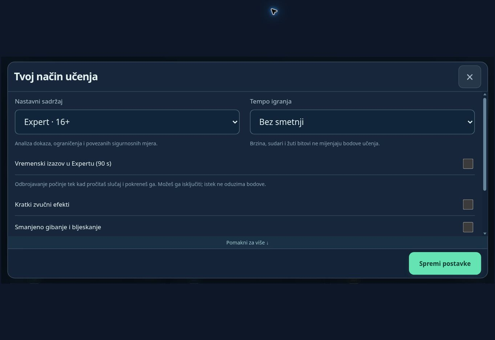
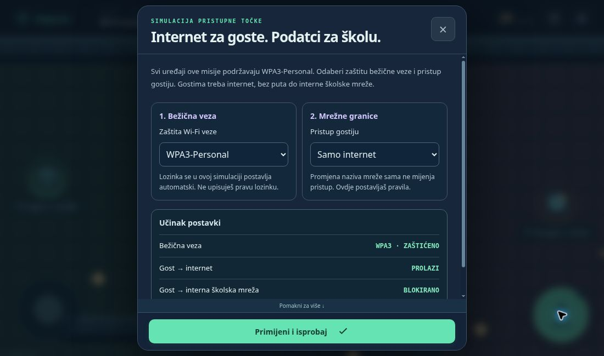
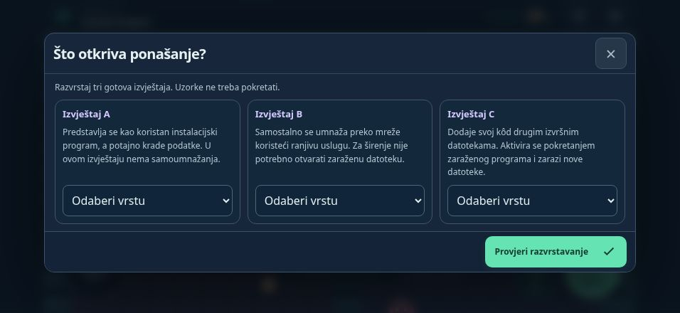
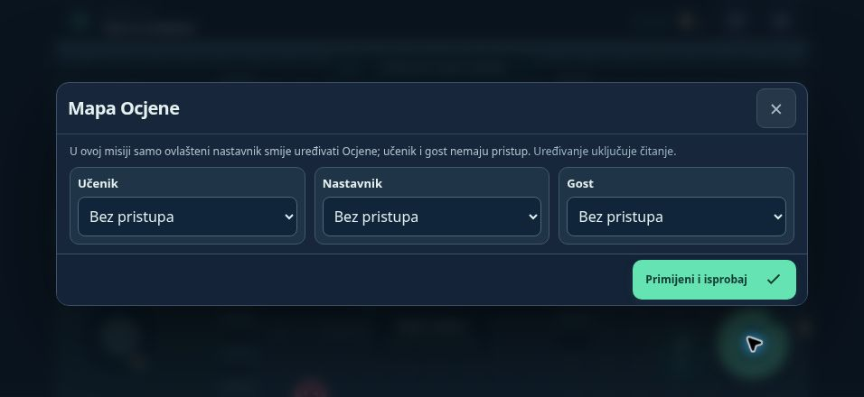
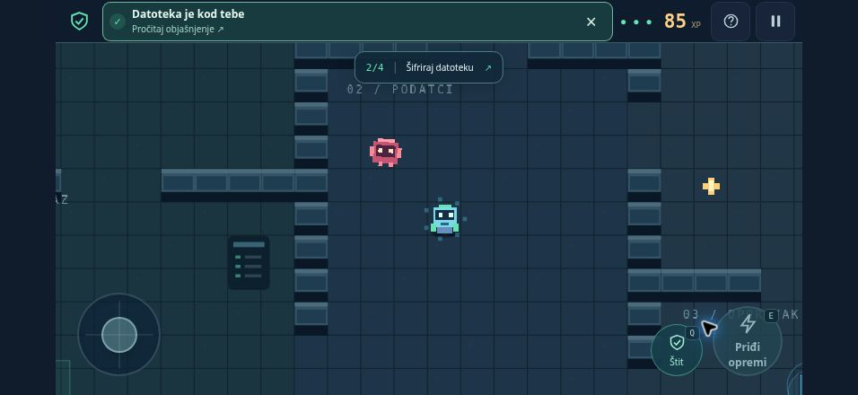

# SISgame — Čuvari sustava

Poučna 2D arkada za predmet **Sigurnost informacijskih sustava**, prvenstveno za uzrast **13–18 godina**, uz jednostavniji sadržaj za mlađe igrače. Inačica **0.10.0** sadrži četrnaest dovršivih misija, četrnaest dodatnih slučajeva za primjenu, pregled rada s prijenosom napretka, hrvatske upute, dodirne kontrole i tipkovnicu.

## Vježbe po temama — novo u 0.10.0

Na početnoj karti odaberite **Vježbe po temama**. Svih 14 misija dostupno je bez prethodnog dovršavanja kampanje. Pretraživanje traži i pojmove iz pouka i rječnika, prepoznaje upite bez hrvatskih dijakritičkih znakova te ne mijenja redoslijed tema. Razina Junior / Standard / Expert bira se u katalogu, a tempo pri otvaranju konkretne vježbe. Nova vježba nudi tempo **Bez smetnji**; nastavak pamti prethodni tempo. Početni Expert sat prati postavke igre i ostaje opcionalan.

Prije zahtjevnijih tema odjeljak **Podsjeti se prije ove teme** nudi objašnjenja preuzeta iz ranijih pouka, prilagođena odabranoj razini. Junior ih vidi otvorene. Zatim se prikazuje pouka odabrane misije s ishodom i razrađenim primjerom. To omogućuje slobodan izbor teme bez pretpostavke da je učenik već prošao cijelu kampanju.

- **Svaka tema i svaka razina čuvaju vlastiti nedovršeni pokušaj.** U pauzi odaberite Odaberi drugu temu; povratak na prethodnu temu vraća odluke, odabire u konzolama, ispravke i položaj. Pauza odmah sprema trenutačno stanje.
- **Rezultati su odvojeni od kampanje.** Tematska vježba ne prepisuje započetu kampanju i ne otključava njezine misije. Dovršena tema otvara svoj dodatni slučaj u tematskom načinu. Prvi rezultat tog slučaja i ispravci također su odvojeni.
- **Moj rad** ima izbor Kampanja / Vježbe po temama te odvojene preglede za Junior, Standard i Expert. Započete teme mogu se nastaviti iz pregleda. Najbolji rezultati ostaju sačuvani pri ponavljanju; bodovi dvaju načina ne zbrajaju se u jednu ocjenu.
- **JSON i TXT obuhvaćaju oba načina rada.** JSON prenosi i sve tematske pokušaje i njihove dodatne slučajeve. TXT jasno razdvaja rezultate i popisuje započete teme. Pregled prije obnove uspoređuje oba načina u svim trima razinama.

Format kopije ostaje `sisgame-progress` verzija 1 uz `schema: 2`. Svaki profil može imati dodatno polje `topics` (`best`, `drafts`, `practice`); nema ga u starim zapisima dok se ne započne tematski rad. Stare kopije ostaju čitljive. **Za kopiju s tematskim radom potrebna je inačica 0.10.0 ili novija.** Obnova starije kopije bez tog rada zamjenjuje tematske zapise praznim stanjem, što je navedeno prije potvrde; prethodni zapis omogućuje povratak. Kao i prije, obnova zamjenjuje cjelinu i ne spaja rezultate.

## Metodika i računalo — novo u 0.9.0

[Metodička i didaktička analiza](PEDAGOGY.md) povezuje nalaze u prethodnoj inačici s prilagodbama svih 14 misija. Svaka misija sada ima **opažljiv ishod, kraći ishod za Junior, razrađen primjer (situacija → razlog → odluka), plan četiriju stvarnih zadaća i završno pitanje za obrazlaganje**. Pouka je prikazana prije zadatka, a primjer i plan otvaraju se po potrebi. Na kraju učenik najprije pokušava objasniti odluku, zatim može otvoriti primjer obrazloženja; sljedeća istaknuta radnja vodi na novi slučaj primjene.

U uvodu se može odabrati **Zaigraj bez smetnji**, uz očuvanu razinu sadržaja i već provedene odluke. U kampanji to postavlja tempo bez smetnji i za iduće misije dok ga učenik ponovno ne promijeni. U tematskoj vježbi mijenja tempo samo tog pokušaja. Oznaka rezultata **bez ispravka** zamjenjuje izraz „samostalno”: 100 bodova znači četiri dovršene zadaće uz dostupnu pomoć.

Na računalu su vidljive upute za tipkovnicu i miš, kompaktne akcijske tipke i karta odvojena od kontrola. Na zaslonu od najmanje 1100 × 600 CSS piksela plan misije stoji pokraj karte. Kamera uzima u obzir i visinu raspoloživog prikaza. Na manjim zaslonima plan je dostupan u pouci.

**Postavke → Prikaz upravljanja** nudi Automatski, Tipkovnica i miš ili Dodir. Automatski izbor koristi mogućnosti pokazivača, uz podršku za hibridne uređaje. Ručni izbor pamti se zasebno na tom uređaju (`sisgame.controls.v1`); ne mijenja format kopije napretka niti se prenosi JSON kopijom. Tipkovnica i dodirna putanja ostaju dostupni u oba prikaza.

Tipke igre djeluju dok karta ima fokus. Otvaranje prozora, Tab na izbornik i odlazak u pozadinu otpuštaju kretanje; povratak iz pouke i pauze vraća fokus na kartu. Strelice i razmak u obrascima zadržavaju svoje uobičajeno ponašanje. Desna i srednja tipka miša ne zadaju putanju. Mobilna palica zadržava aktivni prst ako se drugim prstom dodirne kontrola.

## Jedna igra, tri razine sadržaja

| Nastavni sadržaj | Orijentacijska dob | Prilagodba zadataka |
| --- | --- | --- |
| Junior | 11–13 | Kraće pouke i ishodi, plan zadaća, dva izvještaja i jednostavniji izbori; dio postavki je pripremljen. |
| Standard | 14–16 | Puni scenariji, objašnjenja pojmova i postupno povezivanje zaštitnih mjera. |
| Expert | 16+ | Dodatna analiza dokaza i ograničenja u svakoj misiji; završna provjera traži obrazložen plan od tri odluke. |

**Nastavni sadržaj i tempo igranja biraju se odvojeno.** Svaki sadržaj može se igrati bez smetnji ili uz lagan, srednji odnosno brz arkadni tempo. Tempo kampanje može se promijeniti i za započetu misiju preko postavki na karti, uz sačuvane sigurnosne odluke. Tempo tematske vježbe bira se pri njezinu otvaranju. Expert nema obvezno odbrojavanje: opcionalni izazov od 90 sekundi počinje tek pritiskom na tipku nakon čitanja slučaja. Može se isključiti tijekom zadatka. Zatvaranje prozora i odlazak u pozadinu pauziraju mjerenje; istek dopušta nastavak bez kazne.

Dobne oznake su razvojna i pedagoška preporuka, **nisu formalna PEGI klasifikacija**. Igra ne traži datum rođenja. Odabir treba prilagoditi predznanju, čitanju i potrebama učenika; primjerenost treba potvrditi testiranjem u razredu.



## Što je u igri

1. **Zaključaj rizik** — kontrola ulaza, UPS, osjetljivi ispisi i provjera mjera.
2. **Samo za ovlaštene** — prava na javni raspored i povjerljivu mapu, šifriranje i provjera prijenosa.
3. **Povratak podataka** — odabir važnih datoteka, odvojena kopija, simulirani kvar, obnova i provjera sadržaja.

4. **Sumnjivi program** — izolacija incidenta, virus/crv/trojanski konj, rootkit i pouzdan oporavak.
5. **Tko se prijavio?** — analiza dnevnika, opoziv sesija, jedinstvena lozinka, MFA i provjera prijave.
6. **Ojačaj sustav** — službene nadogradnje, standardni račun/UAC, potrebne usluge i provjera dostupnosti.
7. **Ne nasjedaj poruci** — pregled izmišljene lažne poruke, neovisna provjera, prijava i siguran nastavak rada.
8. **Mreža pod nadzorom** — HTTPS, pravila dopuštenih veza, upozorenje o certifikatu i provjera zaštite.
9. **Trag iza alarma** — IDS/IPS, razvrstavanje upozorenja prema dokazima, ciljani odgovor i provjera dopuštenog rada.
10. **Wi-Fi za prave goste** — provjera mreže, WPA3-Personal, odvajanje gostiju, održavanje i provjera pristupa.
11. **Što prvo zaštititi?** — popis imovine, procjena prioriteta, izbor mjera uz ograničene resurse i provjera preostalog rizika.
12. **Smireno kroz incident** — činjenična prijava, slaganje plana postupanja, izbor čiste kopije i odobren povratak uz nadzor.
13. **Je li sadržaj isti?** — pouzdana referenca, usporedba SHA-256, postupak pri nepodudaranju i nova provjera.
14. **Čiji je potpis?** — privatni i javni ključ, potpis i povjerenje u izvor te zasebna zaštita povjerljivog priloga.

Kampanja ima **56 sigurnosnih zadaća po razini sadržaja**. Ploča rizika povezuje vjerojatnost i učinak s prioritetom. Plan mjera prikazuje trošak i očekivani preostali rizik dok učenik bira zaštitu. Konzola odgovora prikazuje posljedice odabranog slijeda, uključujući preuranjenu obnovu i gubitak dokaza.

Junior uspoređuje dva rizika, ima tri jedinice rada i pripremljen srednji korak odgovora. Standard i Expert procjenjuju tri rizika te raspolažu s pet jedinica rada. Expert dodatno provjerava ograničenja kopije i ovlasti nakon obnove. Svi novi odabiri spremaju se za nastavak. Ljestvica rizika i jedinice rada su izmišljeni školski model, a ne univerzalna formula ili stvarni troškovnik.



Nove misije imaju različite prolaze, boje prostorija i opremu. Uz odluke na terminalima dodani su razvrstavanje izvještaja, pregled dnevnika i upravljačka ploča usluga. Završne provjere prikazuju učinak mjera; rezultati nude i pitanje za primjenu gradiva.

[Nastavni sadržaj, rješenja i stručni izvori](CONTENT.md) opisani su zasebno. Svaka razina sadržaja ima svoj napredak i započetu misiju. Postojeći napredak iz 0.1.x i 0.2.x automatski se prenosi u Standard; dovršena deseta misija otključava jedanaestu bez brisanja postojećih rezultata.



Svaku misiju otvara kratka pouka. Lik istražuje prostorije, izbjegava arkadne smetnje i rukuje opremom. Sigurnosne postavke imaju objašnjene posljedice. Četiri završene zadaće donose 100 bodova učenja; žuti bitovi donose zaseban bonus. Bilježi se je li odluka prihvaćena bez ispravka ili uz ispravak. Pomoć je dostupna u oba slučaja; rezultat nije dokaz rada bez pomoći. Ponavljanje čuva najbolji rezultat i ne umnaža iste bodove. Misije se otključavaju redom.

**Simulacijska ograničenja:** prikaz prijetnji, provjera kartica, električne zaštite, šifriranja i kopiranja je didaktički model. Crvene pokretne smetnje i štit su arkadne prepreke, ne model rada antivirusnog programa. Podatci su izmišljeni. Program ne pristupa stvarnim školskim sustavima i ne izvodi stvarne sigurnosne napade.

## Sažetci i potpisi — novo u 0.8.0

Misija 13 uvodi **hash** kao sažetak sadržaja. Konzola uspoređuje stvarne, unaprijed izračunane SHA-256 vrijednosti zadanih poruka: promijenjeno vrijeme uz isti naziv daje drugi sažetak, a preimenovani isti sadržaj zadržava sažetak. Gumb za usporedbu pomaže učeniku pročitati rezultat. Očekivana vrijednost dolazi iz potvrđenog školskog izvora; podudaranje samo po sebi ne dokazuje bezopasnost datoteke.

Misija 14 odvaja **prolazak provjere potpisa** od **povjerenja u vlasnika javnog ključa**. Učenik mijenja ključ i prati rezultat za izvorni zapis, izmijenjeni zapis i zapis potpisan nepotvrđenim ključem. Potpis koji prolazi uz ključ iz nepoznate poruke ne odobrava automatski školsko podrijetlo. Provjera potpisa u igri nastavni je model sa zadanim zapisima, a ne alat za provjeru stvarnih potpisa ili certifikata. Povjerljivi prilog zasebno dobiva šifriranje i ograničen pristup unutar simulacije.

Junior obrađuje po dva primjerka, Standard i Expert po tri. Pojmovi su uvedeni u pouci prije konzole. Expert zatim razmatra nepouzdan izvor sažetka odnosno valjan potpis uz nedopuštenu uputu. Dodana su i dva nova slučaja primjene: **Fotografija za školski arhiv** i **Potpisana potvrda za putovanje**. Sve nove odluke i odabrani ključ čuvaju se za nastavak i ulaze u kopiju napretka.

Dovršena 12. misija otključava 13., a ona 14. Postojeći lokalni zapisi i JSON kopije iz 0.7.0 zadržavaju rezultate, dodatnu primjenu i aktivni pokušaj. Nove misije i njihovi slučajevi počinju neriješeni.

## Primjena znanja nakon misije — novo u 0.6.0

Na karti odaberite **Primjena znanja**, ili nakon završetka misije **Primijeni u novom slučaju**. Svaka završena misija otključava svoj novi slučaj: nenajavljeni serviser, školski list, snimke izložbe, robotski dodatak, posuđeni tablet, školski radio, QR kod za izlet, web-predaja, mrežni alarm, dan otvorenih vrata, prioritet zaštite i povratak sustava posudbe. U 0.8.0 dodani su fotografija za arhiv i potpisana potvrda za putovanje.

- Junior ima kraći opis i dva ponuđena odgovora po pitanju. Standard ima tri. Obje razine biraju postupak i razlog; Expert dodaje treće pitanje uz novi dokaz ili ograničenje.
- Podsjetnik i pouka dostupni su tijekom rješavanja. Vrijeme se ne mjeri; slučajevi ne mijenjaju 100 bodova po misiji, arkadni bonus ni otključavanje sljedeće misije.
- Nepotpuna predaja ne broji se kao pokušaj. Potpun odgovor dobiva objašnjenje uz svako pitanje. Ponovni pritisak bez promjene odgovora ne povećava broj pokušaja.
- Nedovršeni odabiri i posljednja predaja čuvaju se odvojeno po razinama. Riješen slučaj ostaje dostupan za čitanje, s oznakom **iz prve** ili **uz ispravak**; pregled preporučuje teme u kojima je trebala korekcija.
- „Iz prve” opisuje prvu potpunu predaju uz dostupnu pomoć. To je povratna informacija za vježbanje, ne dokaz samostalnog praktičnog rada. Nakon rješenja slijedi mali prijedlog primjene uz nastavnika.

## Moj rad i kopije — novo u 0.7.0

Na početnoj karti odaberite **Moj rad**, ili **Postavke → Upravljanje napretkom → Moj rad i kopije**. Pregled po razinama prikazuje završene misije, najbolje rezultate, aktivni pokušaj, dodatnu primjenu i teme za ponavljanje. Promjena razine u tom pregledu ne mijenja odabrani sadržaj igre.

- **Preuzmi kopiju (JSON)** čuva sve tri razine, postavke, započete misije i nedovršene odabire. Sačuvajte datoteku izvan podataka preglednika; na drugom uređaju otvorite igru i odaberite je pod **Obnovi napredak iz JSON kopije**.
- **Preuzmi sažetak (TXT)** daje čitljiv pregled svih triju razina i svih misija, uz odvojene bodove učenja i arkadni bonus. Sažetak služi čitanju i razgovoru o radu; za obnovu je potreban JSON.
- Odabir kopije najprije otvara usporedbu trenutačnog rada i učitanih podataka. **Tek potvrda zamjenjuje sve tri razine i postavke; zapisi se ne spajaju.** Nečitljive, nepotpune ili nepodržane kopije i datoteke veće od 1 MiB odbijaju se prije zamjene.
- Prije svake obnove igra sprema jedan prethodni zapis. **Pregledaj prethodni zapis za povratak** omogućuje njegovu usporedbu i obnovu. Ako spremanje prethodnog zapisa ne uspije, obnova se ne primjenjuje. Taj lokalni zapis nije zamjena za preuzetu kopiju: brisanje lokalnog napretka ili podataka preglednika uklanja i njega.
- Prije spremanja provjerava se je li drugi prozor promijenio lokalni napredak. Ako se promjena otkrije, igra zaustavlja prepisivanje i traži da sačuvate otvoreni rad kao kopiju te osvježite igru. Ovo nije sustav istodobnog rada ni automatska sinkronizacija.

Datoteke se pripremaju lokalno; igra ih ne šalje nastavniku ili poslužitelju. Preglednik određuje način preuzimanja ili otvaranja datoteke. Format kopije je `sisgame-progress`, verzija formata `1`, s inačicom igre u polju `gameVersion` i napretkom `schema: 2`; prethodni zapis koristi zaseban ključ `sisgame.restore-point.v1`. Provjera formata ne potvrđuje identitet ili istinitost rezultata.

## Mobilni vodoravni prikaz (0.1.2)

U postavkama pristupa Učenik, Nastavnik i Gost prikazani su u tri stupca, tako da se sve tri ovlasti vide odjednom. Naslov, zatvaranje i glavne tipke ostaju vidljivi; dugi sadržaj ostalih prozora može se pomicati.

Obavijest se sada prikazuje unutar postojeće statusne trake i ne mijenja visinu igrališta. Dodir sažetka otvara cijelo objašnjenje i pauzira igru. Poruka ostaje 12 sekundi, može se zatvoriti, a posljednje objašnjenje dostupno je i iz pauze preko tipke **Posljednja poruka**.

Visina igre prati vidljivo područje preglednika pri promjeni orijentacije i prikazu traka preglednika, uz očuvano korisnikovo zumiranje. Kontrole poštuju sigurne rubove zaslona.





## Pokretanje i upravljanje

- **Mobitel:** virtualna palica lijevo, `Djeluj` i `Štit` desno. Podržan je istodobni dodir palice i tipke.
- **Računalo, kada karta ima fokus:** WASD ili strelice za kretanje, E za radnju, G za put do cilja, H za pouku, Q ili razmak za štit, Esc za pauzu. Klik lijevom tipkom miša na tlo zadaje putanju.
- **Izbornici i obrasci:** Tab / Shift+Tab za kretanje po kontrolama, Enter ili razmak za gumb, strelice za odabire. Klik na kartu ili zatvaranje prozora vraća upravljanje likom.
- **Pomoć pri kretanju:** dodir/klik tla ili trenutačnog cilja pokreće kretanje do odredišta uz obilazak zidova. Ručno kretanje prekida tu putanju.
- Igra se prilagođava uspravnom i vodoravnom zaslonu. Na mobitelu je vodoravni prikaz pregledniji.
- U pozadini se igra pauzira. Zvuk je početno isključen, a postavke nude smanjeno gibanje.
- Tempo mijenja samo arkadne smetnje i oznaku cilja na tlu. U načinu **Bez smetnji** nema sudara ni potrebe za štitom. Dodir cilja i dalje vodi do sljedeće stanice.

## Objava na GitHub Pagesu — ručno, kada vlasnik odluči

**Repozitorij ne uključuje automatsku objavu niti sam uključuje Pages.** Spremna statička inačica nalazi se u mapi [`docs/`](docs/).

Kada želite objaviti:

1. U repozitoriju otvorite **Settings → Pages**.
2. Kao izvor odaberite **Deploy from a branch**.
3. Odaberite granu **main** i mapu **/docs**, zatim spremite.
4. Koristite adresu koju nakon dovršene objave prikaže GitHub.

Sve putanje su relativne, a manifest i service worker ograničeni na mapu igre. Igra nema ovisnosti o vanjskom CDN-u, fontovima ili API-ju tijekom igranja. `docs/` već sadrži izgrađeni Phaser i ostale datoteke, pa za samu objavu nije potrebna instalacija Nodea.

## PWA i offline

Nakon prvog uspješnog učitavanja preko HTTPS-a, service worker sprema **sve datoteke konkretne inačice**. Gumb za instalaciju pozeleni tek nakon provjere da su datoteke u predmemoriji. Android omogućuje instalaciju kroz Chrome; na iPhoneu koristite Safari → Dijeli → Dodaj na početni zaslon. Samo dodavanje ikone ne jamči da su datoteke preuzete. Za novu inačicu treba mreža; ponuđeno ažuriranje primjenjuje se na korisnikov zahtjev.

Preglednik može obrisati lokalnu pohranu ili predmemoriju, primjerice nakon korisnikova brisanja podataka. Tada je za ponovno preuzimanje potreban internet. Offline rad nije dostupan otvaranjem `index.html` kao obične `file://` datoteke.

## Napredak i vrednovanje

Napredak se sprema u `localStorage` pod zadržanim ključem `sisgame.save.v1`, bez imena i prijave. Format je sada `schema: 2`, s odvojenim profilima za Junior, Standard i Expert; stari `schema: 1` migrira se u Standard. Profil dodatno sadrži `practice`: odabire, posljednju potpunu predaju, broj pokušaja, riješenost i točnost prve predaje dodatnih slučajeva. Stariji zapis bez tog polja dobiva praznu evidenciju bez gubitka kampanje. Spremanje se obavlja tijekom igranja, nakon odluka i pri napuštanju. Ako je pohrana blokirana, igra prikazuje upozorenje i nastavlja raditi.

Statusna traka i kampanja prikazuju samo bodove učenja. Arkadni bonus prikazuje se zasebno u pauzi i rezultatu. Brzina, sudari, energija i istek opcionalnog vremena ne mijenjaju bodove učenja ni oznaku samostalne odluke. Rezultati različitih razina sadržaja nisu usporedive standardizirane ocjene.

Lokalni rezultati su evidencija vježbanja, **nisu kriptografski dokaz znanja ili identiteta**. Korisnik može izmijeniti podatke u svojem pregledniku. Za pouzdano formalno vrednovanje potrebni su prijava, poslužiteljska obrada provjerljivih događaja i odgovarajuća provjera samostalnosti; samo potpisivanje broja bodova koji je poslao klijent nije dovoljno.

## Razvoj

Izgradnja traži Node.js 22.12+; dodatne provjere sučelja (`test:ui`) koriste Node.js 22.13+ ili noviji podržani LTS. Cijeli postupak provjeren je na Node.js 24.22.1.

```sh
npm ci
npm run dev
npm test
npm run test:ui
npm run build
```

`npm run build` provjerava TypeScript, izrađuje `docs/` i generira potpun popis datoteka za offline predmemoriju. Izvorni kôd je u `src/`; `docs/` treba ponovno izgraditi nakon svake izmjene. Nakon izmjene potrebno je commitati i izvorne i izgrađene datoteke. Ovisnosti su zaključane u `package-lock.json`.

- `src/curriculum.ts` — razine sadržaja, Junior prilagodbe, pojmovi i Expert slučajevi.
- `src/network.ts` — sigurnosni zapisi, Wi-Fi postavke i izračun prikazanih posljedica.
- `src/operations.ts` — slučajevi rizika, planiranje mjera, redoslijed odgovora i prikaz posljedica.
- `src/integrity.ts` — SHA-256 primjeri, prilagodbe razinama i model potpisa s odvojenom provjerom povjerenja.
- `src/practice.ts` — 14 dodatnih slučajeva, prilagodbe razinama, objašnjenja i evidencija primjene.
- `src/progress.ts` — pregled rezultata, JSON kopije, provjera i obnova uz prethodni zapis te TXT sažetak.
- `src/missions.ts` — sadržaj novih odluka, izvještaji, zapisi i pravila usluga.
- `src/core.ts` — nastavna pravila i prijelazi stanja.
- `src/study.ts` — katalog tema, pretraživanje i priprema iz povezanih pouka.
- `src/learning.ts` — ishodi, razrađeni primjeri, pitanja za obrazlaganje i plan stvarnih zadaća.
- `src/controls.ts` — tipkovnica ograničena fokusom, izbor prikaza kontrola i prilagodba kamere.
- `src/game.ts` — Phaser, mapa, kretanje, prepreke i likovi.
- `src/data.ts` — misije, pouke, mjesta i putanje.
- `src/main.ts` — izbornici, kontrole, konfiguracija zaštite i PWA.
- `src/storage.ts` — odvojeni napredak kampanje i tema, validacija formata, pokušaji i najbolji rezultati.
- `tests/` — provjere ključnih pravila, oporavka podataka, putanja i spremanja.
- `scripts/check-ui.mjs` — lokalne provjere kataloga i tematskog rada, nastavnih koraka svih misija, tipkovnice i dodirnog stanja, kontrola misija 11–14, svih dodatnih slučajeva i upravljanja kopijama uz Happy DOM; nema pristupa mreži, stvarnom pregledniku ni igraćem platnu. Happy DOM je samo razvojna ovisnost.

## Provjera prije uporabe u razredu

Za **0.10.0** prošli su produkcijska izgradnja i provjera tipova, offline paket, **104/104 testa** i **986 lokalnih DOM provjera**. Dodane su provjere slobodnog izbora tema, prilagođenih podsjetnika, odvojenih pokušaja i rezultata, promjene teme, nastavka nakon ponovnog učitavanja, dodatnih slučajeva u pravilnom načinu i razini, izvoza/obnove oba načina te povratka nakon obnove starije kopije. Nova izmišljena testna kopija proizvedena je neizmijenjenim izvornim kodom 0.9.0; starija 0.7.0 kopija i dalje se provjerava.

Za **0.9.0** prošli su TypeScript, produkcijska izgradnja, offline paket, **95/95 testova** i **879 lokalnih DOM provjera**. Nove provjere obuhvaćaju ishode, primjer, plan i završno obrazlaganje u svih 14 misija i trima razinama, poštene oznake rezultata, očuvanje odluka pri promjeni tempa, tipkovnicu s fokusom, nativne obrasce, povratak iz pauze, prebacivanje kontrola i razdvojene dodirne i tipkovničke osi. Tri testa izvršavaju stvarne metode scene za kretanje i klikove uz zamijenjene Phaser objekte za crtanje; ne renderiraju platno. Sve ranije provjere kopija i migracije ostaju uključene.

104 automatiziranih testova provjerava pravila svih četrnaest misija u sve tri razine sadržaja, dostupnost mjesta na svakoj mapi, preduvjete, pogrešne odluke, sprečavanje ponovnog zbrajanja bodova, migraciju starog napretka, neovisne profile, opcionalni sat, odvojeno bodovanje, 14 dodatnih slučajeva, stvarne SHA-256 vrijednosti, granice modela potpisa, čuvanje prvog rezultata, kopije i obnovu napretka te offline paket. Pregled u računalnom pregledniku ne zamjenjuje probu na stvarnom iPhoneu i Androidu. Prije nastavne uporabe provjerite višestruki dodir, okretanje zaslona, zaključavanje/otključavanje, povratak nakon zatvaranja, zvuk, offline pokretanje i ažuriranje.

Postavke, Junior obrasci, Expert analiza i mrežna konzola provjereni su u Chromeu na 956 × 440, 956 × 378 uz simulirane sigurne rubove, 568 × 320 i 390 × 844. Dulji sadržaj pomiče se unutar prozora; zatvaranje i glavna tipka ostaju dostupni. Provjereni su ispravak Expert odgovora, nastavak nakon isteka vremena i povratak u započetu misiju nakon promjene sadržaja.

Nove konzole iz 0.4.0 dodatno su provjerene u Chromeu unutar prikaza 956 × 440, 568 × 320 i 390 × 844, s odvojenim izmišljenim testnim napretkom. Provjereni su ispravak odgovora, ponovno učitavanje nedovršenih odabira, Junior pojednostavljenja i Expert završni slučajevi. Na 568 × 320 zapisi se nižu jedan ispod drugoga, a glavna tipka i zatvaranje ostaju dostupni. To je provjera rasporeda u računalnom pregledniku, ne test višestrukog dodira na fizičkom telefonu.

Za **0.8.0** prošli su TypeScript, produkcijska izgradnja, offline provjera paketa i automatizirani testovi (**85/85**). Dodatne **453 lokalne DOM provjere** obuhvaćaju konzole misija 11–14, svih 14 dodatnih slučajeva u svakoj razini te Moj rad. Nove provjere uključuju usporedbu sažetaka, promjenu ključa, razliku valjanog potpisa i potvrđenog izvora, ispravke, nastavak odabira, završne izvještaje, otključavanje misija i učitavanje kopije izrađene neizmijenjenim kodom 0.7.0. Testni napredak je izmišljen. Provjere se pokreću pomoću `npm run test:ui`; učitavaju stvarni kod sučelja uz zamijenjeni Phaser, preuzimanje i memorijski DOM, bez mreže.

**Vizualni pregled prikaza dodanih u 0.5.0–0.10.0 nije proveden.** Pristup lokalnoj testnoj adresi ranije je blokiran automatskom provjerom alata. DOM provjere ne potvrđuju izgled, raspored, dodirne kontrole, prikaz igraćeg platna ni stvarni dijalog odabira i spremanja datoteke. Ranije navedene provjere zaslona odnose se na 0.4.0 i starije prikaze. Prije nastavne uporabe 0.10.0 treba vizualno pregledati na računalu (široki i niski prozor, zumiranje i hibridni uređaj) te na uspravnom i vodoravnom mobilnom zaslonu, uz probu preuzimanja i obnove. Potrebno je isprobati preuzimanje, prijenos kopije i obnovu na stvarnim uređajima.

Nastavni okvir obuhvaća sedam cjelina i 26 tema. Ova inačica ima četrnaest misija koje objedinjuju dio tema; ne pokriva svih 26 nastavnih tema. Procjena imovine i rizika, plan odgovora, sažetci i digitalni potpisi imaju samostalne misije. Dodani slučajevi vježbaju primjenu na novim činjenicama. Za daljnji razvoj ostaju dodatne varijante, provjera prijenosa u stvarni praktičan rad i pilotiranje u razredu. Detaljna veza s gradivom nalazi se u [CONTENT.md](CONTENT.md).

## Izvori i ovisnosti

Nastavni okvir: korisnikov priručnik SIS v4 i GIK za 4. razred. Projekt uključuje izvorno izrađene vektorske/pikselne elemente i generirane tonske efekte. Nema vanjskih fotografija ili preuzetih likova.

Phaser 3.90.0 i EventEmitter3 uključeni su pod MIT licencama; vidi [`public/THIRD_PARTY_NOTICES.txt`](public/THIRD_PARTY_NOTICES.txt). Vite i TypeScript koriste se samo tijekom razvoja i izgradnje.
